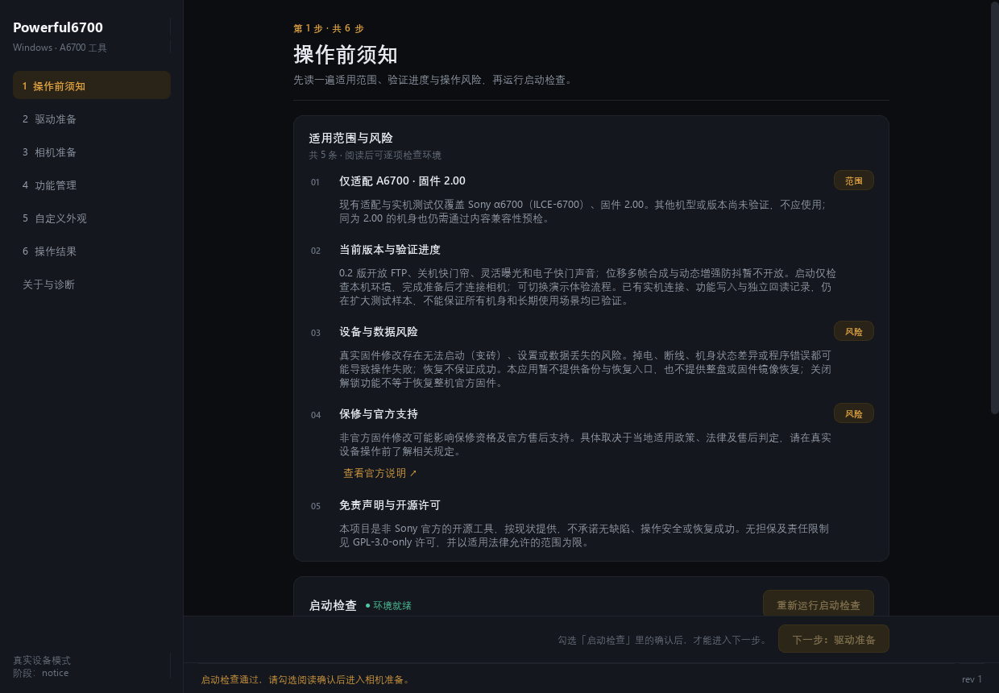
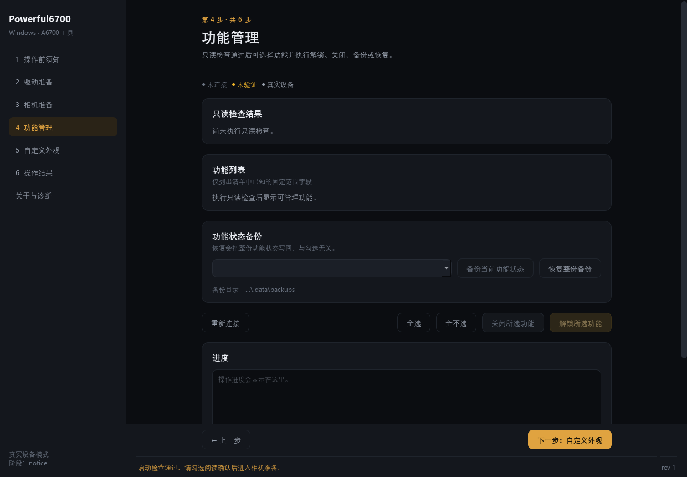
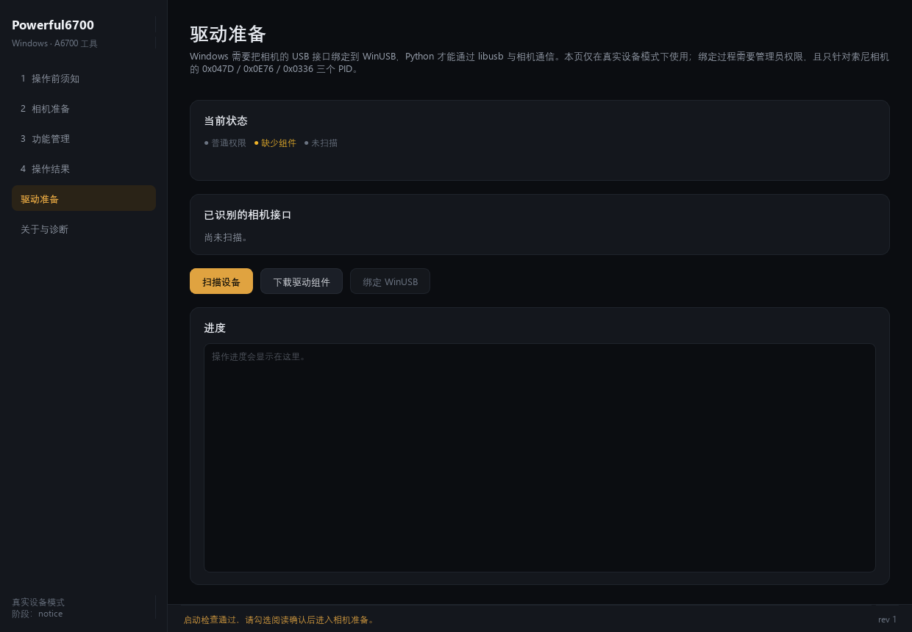
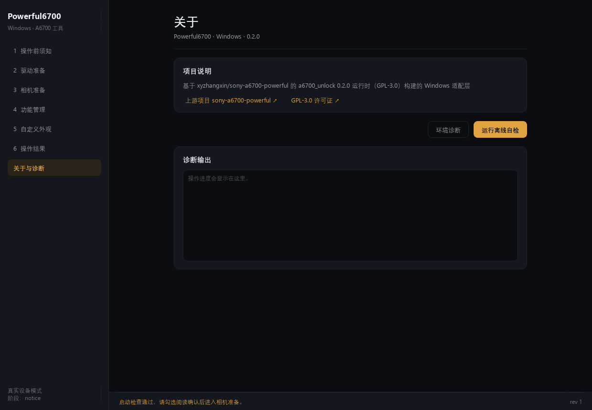

# Powerful6700 · Windows

[](https://github.com/wanghm105/Powerful6700-Windows/releases/latest)
[](https://github.com/wanghm105/Powerful6700-Windows/releases/latest)
[](https://github.com/xyzhangxin/sony-a6700-powerful)
[](LICENSE)

给 **Sony A6700（ILCE-6700）固件 2.00** 用的 Windows 桌面工具：只读兼容性预检、功能解锁／关闭、功能状态备份与整份恢复，全部在一个窗口里按按钮完成。

它在 [**xyzhangxin/sony-a6700-powerful**](https://github.com/xyzhangxin/sony-a6700-powerful)（上游 0.2.0，GPL-3.0）的 Python 运行时之上工作——**上游的设备连接层只支持 macOS / Linux，Windows 上完全跑不起来**，本仓库就是把这部分换成 Windows 实现，并把桌面外壳与打包方式一起重做成 Windows 桌面应用。

## 它做了什么（速览）

**在 Windows 上，给 A6700 一个能用的图形界面：解锁和关闭机身隐藏功能，动手前先只读体检，改完还能整份退回。**

- **一键解锁／关闭四项功能** —— 原生 FTP 菜单与开关、关机快门帘、灵活曝光、电子快门声音；勾选后一键写入，机上菜单立刻生效（断电重启后验收）。
- **先体检，再动相机** —— 只读检查 260 个扇区（133,120 字节），逐字节比对已知字段与结构守卫；出现任何未知偏差就整次中止，**没有强制开关**，不会「带病写入」。
- **改完能退回** —— 生成 `.a6700backup` 功能状态快照（带 SHA-256），一键**整份还原**并独立回读校验（真机实测 `restored`、134 扇区 / 326 字节）。
- **Windows 链路是真的通** —— 一键绑定 WinUSB（需要时自动提权）、进服务模式后自动为新出现的 `0x0336` 补驱动、相机卡在服务模式时自动救援，不用你拔插找驱动。
- **绿色版零依赖** —— 双击 `Powerful6700.exe` 即可，自带 Python 运行时与 libusb；不接相机也能跑离线自检与界面预览。

> 写入结果是可判定的：`completed`／`no-op`／`blocked`／`rolled-back`／`uncertain`／`verification-failed`／`recovery-required`，每种都有明确含义，程序不会用「成功」两个字糊过去。

## 支持的机型

> [!IMPORTANT]
> **只支持 Sony A6700（ILCE-6700），固件 2.00。**其他机型（包括 A7C II、A7CR、A7 IV、A7R V、A7 V、ZV-E10 等）都**不能**使用，本程序不提供、也无法提供兜底。

其他机型可以关注这些完全独立的项目，支持范围与风险以各自说明为准：

| 机型 | 项目 | 内容 |
| --- | --- | --- |
| A7C II | [QAQLeonard/a7c2-fl23-research](https://github.com/QAQLeonard/a7c2-fl23-research) | FL2／FL3、自定义创意外观、电子快门声音、竖屏显示（Windows/macOS 桌面工具） |
| A7C II | [MDHan/a7c2-fl23-macos](https://github.com/MDHan/a7c2-fl23-macos) | 上面那个项目的 macOS 适配 |
| A6700 | [**xyzhangxin/sony-a6700-powerful**](https://github.com/xyzhangxin/sony-a6700-powerful) | **本项目所基于的上游项目**：Pico 接线、Fastboot、备份、功能解锁（macOS） |
| 其它 | [chocotan/a7c2-re](https://github.com/chocotan/a7c2-re)、[YuuLuo/a7c2-camera-tools](https://github.com/YuuLuo/a7c2-camera-tools) | 固件逆向研究与相机侧工具 |

## 目录

- [它做了什么（速览）](#它做了什么速览)
- [支持的机型](#支持的机型)
- [这个项目和上游是什么关系](#这个项目和上游是什么关系)
- [截图](#截图)
- [功能明细](#功能明细)
- [下载与系统要求](#下载与系统要求)
- [开始前必读](#开始前必读)
- [操作指南](#操作指南)
  - [第 1 步：解压并启动](#第-1-步解压并启动)
  - [第 2 步：驱动准备（只在第一次需要）](#第-2-步驱动准备只在第一次需要)
  - [第 3 步：相机准备](#第-3-步相机准备)
  - [第 4 步：只读检查](#第-4-步只读检查)
  - [第 5 步：解锁或关闭功能](#第-5-步解锁或关闭功能)
  - [第 6 步：备份与恢复](#第-6-步备份与恢复)
- [常见问题](#常见问题)
- [验证状态](#验证状态)
- [命令行与开发](#命令行与开发)
- [来源与许可](#来源与许可)
- [致谢](#致谢)

## 这个项目和上游是什么关系

一句话：**上游的运行时原样保留，Windows 侧全部重写。**

- `third_party/a6700_unlock/` 是上游运行时 [0.2.0](https://github.com/xyzhangxin/sony-a6700-powerful/releases/tag/v0.2.0) 的**逐字节副本**（GPL-3.0，含 LICENSE／NOTICE），固件字段表、写入事务、结果分类、界面状态机都是上游的。
- 本项目自己写的代码只有 `src/a6700win/`（Windows 适配层 + PySide6 界面）、`tools/`、`tests/`、`packaging/`。
- 适配方式不是在运行时里改代码，而是**在启动时注入 22 个替换点**（`src/a6700win/patches.py`，逐项理由见 [docs/ARCHITECTURE.md](docs/ARCHITECTURE.md)），因此上游再发版时可以整目录替换后重新对齐。

我们具体做了什么：

| # | 上游（macOS）的做法 | 本项目（Windows）的做法 |
| --- | --- | --- |
| 1 | `libusb_library_path()` 只认 Homebrew／系统 dylib，没有 Windows 分支 | 走 `libusb-package` 自带的 `libusb-1.0.dll`，冻结包内直接命中 |
| 2 | 靠 macOS 权限弹窗 / 特权 helper 抓 USB（`mac_capture.m`） | **WinUSB 绑定**：用 [libwdi](https://github.com/pbatard/libwdi) 的 `wdi-simple.exe` 把相机 PID 绑到 WinUSB，需要管理员时自动 `ShellExecuteExW(runas)` 提权并回报进度 |
| 3 | 服务模式设备（0x0336）在 libusb 里立即可见 | 该设备在 Windows 上**默认没有任何驱动**（设备管理器 Error 28）→ 先用 SetupAPI 按 PID 发现它，再为它装一次 WinUSB，最后才交给 libusb |
| 4 | PyUSB 单例上下文，反复使用没问题 | PyUSB 1.2.1 会永久缓存一个 libusb context，驱动切换后必须强制重建（`fresh` 已被包装成默认行为） |
| 5 | 设备枚举、产品 ID 观察走 `ioreg` | 走 SetupAPI（`SetupDiGetClassDevsW`），不需要驱动也不需要管理员 |
| 6 | 状态／备份写在 macOS 用户目录 | 可写数据目录探测：`POWERFUL6700_DATA` → exe 同目录 `.data` → `%LOCALAPPDATA%` → 临时目录，保证「提权/不提权」看到同一个目录 |
| 7 | `doctor` 的 `platform` 检查写死 `darwin/linux`，Windows 上恒为 False，会永久阻塞整个流程 | 换成 Windows 判定并把 libusb 行指向实际的 DLL |
| 8 | 写文件用 `os.open(...)` 不带 `O_BINARY`，Windows 会把 `0x0A` 改写成 `0x0D 0x0A`（稀疏备份当场损坏） | 给备份／规划器的 `os` 打上二进制与 `O_NONBLOCK=0` 垫片 |
| 9 | 设备锁、目录 fsync 都是 POSIX 语义 | 用 `msvcrt.locking` 独占锁 + 尽力 fsync；异常时保证放锁并回到正确阶段 |
| 10 | 桌面备份／恢复入口被上游隐藏（`_available_backups()` 返回空，而恢复校验又依赖它 → 永远不可用） | 打开该入口，并让「恢复」按**整份备份**回写（不再受上次勾选残留影响） |
| 11 | SwiftUI 桌面外壳（AppKit + Swift），只出 macOS arm64 包 | PySide6 图形界面 + PyInstaller onedir 冻结包，双击即用，不需要装 Python |
| 12 | 上游在「等待服务模式设备」超时后不会清理，相机会停在 0x0336 | 新增等待期自动退出服务模式（发 `STOP_SENSER` 并等设备回落到 0x0E76），失败给出明确提示 |

顺手回报给上游的两个问题（也已写进 [docs/UPSTREAM-NOTES.md](docs/UPSTREAM-NOTES.md)）：

1. `usb/legacy.py` 的 `run_authentication()` 在「等待服务模式设备」这一步抛错时还没有设备句柄，`except` 里的 `STOP_SENSER` 清理不会执行 → 相机留在服务模式。macOS/Linux 上因为设备立刻可见，不会暴露。
2. `data/native/manifest.json` 的 `source_sha256`（`53cd3393…`）与 `native/transaction.c` 的实际哈希（`f21342ab…`）不一致，全仓库没有这个哈希对应的文件 → `doctor` 的载荷完整性检查在严格模式下必然失败。本项目保留对**真正送到相机的字节**（`reader.elf`／`writer.elf` 与 profile 摘要）的强校验，只把源码文本哈希降级为溯源信息。

## 截图

以下都是本机实拍（离屏渲染，真实界面与真实文案）：

| 操作前须知 | 相机准备 |
| --- | --- |
|  |  |

| 功能管理 | 操作结果 |
| --- | --- |
|  |  |

| 驱动准备 | 关于与诊断 |
| --- | --- |
|  |  |

## 功能明细

| 功能 | 说明 |
| --- | --- |
| **只读兼容性预检** | 读固定窗口的 260 个扇区（133,120 字节），逐项校验已知字段、结构守卫与未管理字节哈希，得出每个功能当前的开关状态。**不写相机。** |
| **解锁／关闭功能** | FTP 菜单与开关、关机快门帘、灵活曝光、电子快门声音（以清单里的可用项为准），可单选也可全选。 |
| **功能状态备份** | 生成 `.a6700backup` 稀疏快照（本机实测 41,582 字节），带 SHA-256。 |
| **恢复整份备份** | 把备份里的功能字段整份写回，再独立回读校验（本机实测 `touched=134` 扇区 / 326 字节）。 |
| **驱动准备** | 一键下载 libwdi 组件并把 0x047D／0x0E76／0x0336 绑到 WinUSB；服务模式设备会在需要时自动补装。 |
| **环境诊断 / 离线自检** | 不接相机也能验证运行环境、载荷完整性、界面可用性（`--offline-self-test`）。 |
| **机身验收提示** | 写入成功后给出「断电重启 → 到菜单里逐项核对」的步骤与每个功能的菜单路径。 |
| **服务模式救援** | 发现相机停在 0x0336 时自动尝试退出，而不是要求你拔插数据线。 |

> [!NOTE]
> **没有**的能力（上游也没实现，本程序不发明）：整盘／完整固件备份与恢复、位移多帧合成（Pixel Shift）、动态增强防抖（Dynamic Active）、FL2/FL3 与第三方创意外观、录像卡速档位修改。详见 [docs/ROADMAP.md](docs/ROADMAP.md)。

## 下载与系统要求

| 系统 | 下载 | 说明 |
| --- | --- | --- |
| Windows 10 / 11 x64 | [`Powerful6700-Windows-x64.zip`](https://github.com/wanghm105/Powerful6700-Windows/releases/latest)（约 40 MB） | 解压即用，绿色版，不需要安装 Python |

- SHA-256：`e20e66cb5a577e24914cfd92ee99e2732013b94f94bc470f45bbd585e668cb4e`
- 首次把相机绑到 WinUSB 需要**管理员权限**，建议右键「以管理员身份运行」。
- 也可以从源码运行：建虚拟环境 → `python -m a6700win`，或直接双击 `启动.cmd`；步骤见 [docs/BUILD.md](docs/BUILD.md)。

## 开始前必读

> [!IMPORTANT]
> 本工具会**修改相机固件里的设置字段**。断电、断线、机身状态差异或程序错误都可能导致操作失败；失败时程序会尽力回滚并如实报告结果，但**不保证一定成功**。请先读完应用内的「操作前须知」，再动手。
>
> - 只改**已知字段**：260 个扇区里每一个字节都参与校验，出现任何未知偏差就整次中止，**没有强制开关**。
> - 不解锁 Bootloader、不刷固件、不需要 Pico 或测试板。
> - 操作期间保持相机开机、接一根数据线、只接**一台**目标相机；关闭 FTP 与「电脑控制」，USB 连接模式选**海量存储(MSC)**。

## 操作指南

### 第 1 步：解压并启动

解压 zip，得到 `Powerful6700` 目录，双击 `Powerful6700.exe`（建议右键「以管理员身份运行」）。

先点「重新运行启动检查」，五项全绿、右下角显示 **● 环境就绪** 后才「进入相机准备」。

### 第 2 步：驱动准备（只在第一次需要）

打开左侧「驱动准备」：

1. 点 **扫描设备**，确认相机被识别为 `0x0E76 Sony A6700 - Storage`；
2. 点 **下载驱动组件**（只下一次，约 4 MB，来自 libwdi 官方 release，缓存在 `.data\driver`）；
3. 点 **绑定 WinUSB**（需要管理员）。绑定成功后资源管理器里的相机盘符会消失，这是正常的。

第一次「只读检查」时相机会切到服务模式，出现新的 `0x0336 Sony A6700 - Service`，程序会自动为它补装驱动，不用你手动操作。

### 第 3 步：相机准备

在相机上依次确认四件事（界面上每项都有菜单路径）：

1. **FTP 功能：关**（首次解锁前没有这个菜单，属正常，可直接勾选「没有 FTP 菜单，直接继续」）
2. **USB 连接模式：海量存储(MSC)**（先拔线再改，别选 MTP／电脑控制／USB 流式传输）
3. **自动关机：关**，并确认电量充足
4. **最后再接线**，只接一台 A6700

四项都勾选后点 **开始只读检查**。

### 第 4 步：只读检查

程序读 260 个扇区并逐项校验，结果页／功能管理页会显示兼容性与六个功能项的状态（四个可用、两个跟随上游禁用）。**这一步不写相机**，如果这里就报不兼容，请停下来把日志贴到 Issue。

### 第 5 步：解锁或关闭功能

在「功能管理」勾选要处理的功能 → **解锁所选功能**／**关闭所选功能**。写入流程是：相机内二次校验前置内容 → 分扇区写入 → fsync → 回读 → 独立再读一遍。结果页会给出状态之一：`completed`／`no-op`／`blocked`／`rolled-back`／`uncertain`／`verification-failed`／`recovery-required`。

看到 `completed` 之后，**按结果页的「机身验收」提示断电重启**，再到菜单里逐项确认。

### 第 6 步：备份与恢复

- **备份当前功能状态** → 在 `.data\backups` 生成 `.a6700backup`，结果页给出路径与 SHA-256；
- **恢复整份备份** → 选下拉里的备份，整份功能字段写回 + 独立回读（与当前勾选无关）；
- 备份要求**同机型 + 同固件**；跨固件／跨机型会被拒。

## 常见问题

**Q：卡在「正在等待相机进入服务模式…」？**
A：旧构建确实会卡住并把相机留在服务模式。当前版本会先用 SetupAPI 发现 `0x0336`、自动装 WinUSB，失败时会尝试自动退出服务模式；如果仍失败，拔插一次数据线即可回到 `0x0E76`。

**Q：设备管理器里显示「无法安装此设备（错误 28）」？**
A：这就是服务模式设备没驱动。点「驱动准备 → 扫描设备 → 绑定 WinUSB」手动装一次，或者直接重试只读检查让程序自动补装。

**Q：绑定 WinUSB 后相机盘符消失了？**
A：正常。绑定后相机不再以 MTP/MSC 出现在资源管理器，只对 libusb 可见。想恢复，在设备管理器卸载该设备再拔插即可。

**Q：「恢复整份备份」是灰的？**
A：需要先完成只读检查（拿到兼容性），并且备份列表里要有**同机型同固件**的 `.a6700backup`。备份目录在界面下方有显示。

**Q：为什么不提供完整固件备份？**
A：上游未实现，本项目不发明。现在提供的是**功能状态**的稀疏快照（260 个扇区），不是整盘镜像，也不能用来救砖。

**Q：Python 需要装吗？**
A：不需要，冻结包自带运行时。源码运行才需要 Python 3.10+ 与 `docs/requirements.txt`。

## 验证状态

**本机真机验证（A6700 + 固件 2.00，2026-10-23）**

| 路径 | 结果 |
| --- | --- |
| 只读检查 | 260 扇区 / 133,120 字节，兼容性通过，六项状态读出 |
| 功能状态备份 | 41,582 字节，SHA-256 复算一致 |
| 解锁写入 | `completed`，相机内二次校验 + 独立回读通过 |
| 关闭写入 | `completed`，`touched=4`，重启后仍为关闭 |
| 备份恢复 | `restored`，134 扇区 / 326 字节回写 + 独立回读 |

**离线验证**：37 个 pytest 用例通过（1 个按环境跳过）、六页界面离屏渲染、冻结包 `--offline-self-test` 九项通过。

**未验证**：失败回滚（需要人为制造相机内校验失败）、跨固件／跨机型拒绝路径、干净机器上从零开始的驱动引导全流程。细节见 [docs/VALIDATION.md](docs/VALIDATION.md)。

## 命令行与开发

```powershell
# 界面
.\Powerful6700.exe

# 离线自检（不接相机）
.\Powerful6700.exe --offline-self-test
.\Powerful6700.exe --offline-self-test --json selftest.json

# 环境诊断（JSON）
.\Powerful6700.exe --diagnose

# 渲染六个页面截图（验证冻结包里的界面）
.\Powerful6700.exe --render-pages shots
```

源码开发：

```powershell
.\.venv\Scripts\python.exe -m pip install --no-index --find-links wheelhouse -r docs\requirements.txt
.\.venv\Scripts\python.exe -m pytest tests -q
.\.venv\Scripts\python.exe -m PyInstaller packaging\Powerful6700.spec --noconfirm
```

| 文档 | 内容 |
| --- | --- |
| [docs/ARCHITECTURE.md](docs/ARCHITECTURE.md) | 22 个补丁点、真实操作顺序、结果分类 |
| [docs/VALIDATION.md](docs/VALIDATION.md) | 已／未验证清单与复现步骤 |
| [docs/BUILD.md](docs/BUILD.md) | 离线建环境、打包、发布 |
| [docs/UPSTREAM-NOTES.md](docs/UPSTREAM-NOTES.md) | 与上游 0.2.0 的逐项差异 |
| [docs/ROADMAP.md](docs/ROADMAP.md) | 上游功能计划表对照与后续方向 |
| [docs/PUBLISHING.md](docs/PUBLISHING.md) | 发布硬条件（GPL、路径、运行期数据） |

## 来源与许可

- 上游：[xyzhangxin/sony-a6700-powerful](https://github.com/xyzhangxin/sony-a6700-powerful) v0.2.0，GPL-3.0-only。运行时副本位于 `third_party/a6700_unlock/`，许可证与 NOTICE 一并保留。
- 本项目同样以 **GPL-3.0-only** 发布：分发本项目的二进制时，请同时提供对应源码（即本仓库同 tag 的代码）。
- 本项目是**非官方**工具，与 Sony 及上游作者均**无隶属关系、也未获其背书**。真实固件修改存在变砖、设置或数据丢失的风险，请自行评估。
- 本项目不含任何固件镜像、密钥、序列号或 ProductInfo 原文；仓库里的转储工具只处理你自己从自己相机读出的文件。

## 致谢

- [xyzhangxin](https://github.com/xyzhangxin)：上游 Powerful6700，固件字段表、写入事务与全部风险控制逻辑都来自这里。
- [QAQLeonard](https://github.com/QAQLeonard)：A7C II Tools 的 Windows 实现是本项目在「产品完整度」上的参照。
- [pbatard](https://github.com/pbatard)：libwdi／Zadig，Windows 驱动绑定这一环靠它。
- [PySide6](https://www.qt.io/qt-for-python)、[PyUSB](https://github.com/pyusb/pyusb)、[libusb](https://libusb.info/)、[PyInstaller](https://pyinstaller.org/) 及 [Sony-PMCA-RE](https://github.com/ma1co/Sony-PMCA-RE)。
