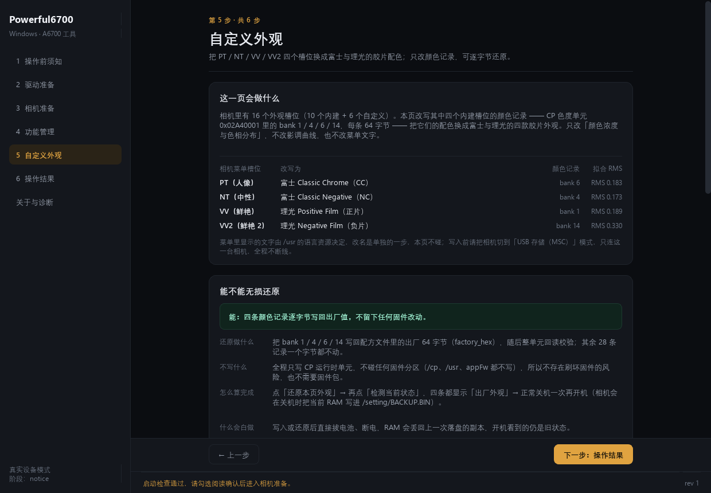

# Powerful6700 · Windows

[](https://github.com/wanghm105/Powerful6700-Windows/releases/latest)
[](https://github.com/wanghm105/Powerful6700-Windows/releases/latest)
[](https://github.com/xyzhangxin/sony-a6700-powerful)
[](LICENSE)

给 Sony A6700（ILCE-6700，固件 2.00）用的 Windows 小工具。解压、双击就能跑，不用装 Python。

它做两件事：把机身里藏着的几项功能打开，也能原样关回去；把菜单里那四个外观换成富士、理光的胶片味道，连菜单上显示的名字一起改。

改过的东西都能还回去。功能关掉就回到出厂状态，颜色和名字也有各自的还原。

## 目录

- [功能状态](#功能状态)
- [自定义外观与菜单文字](#自定义外观与菜单文字)
- [其他机型](#其他机型)
- [这个项目和上游是什么关系](#这个项目和上游是什么关系)
- [下载与系统要求](#下载与系统要求)
- [致谢](#致谢)
- [开始前必读](#开始前必读)
- [操作指南](#操作指南)
  - [第 1 步：解压并启动](#第-1-步解压并启动)
  - [第 2 步：驱动准备（只在第一次需要）](#第-2-步驱动准备只在第一次需要)
  - [第 3 步：相机准备](#第-3-步相机准备)
  - [第 4 步：只读检查](#第-4-步只读检查)
  - [第 5 步：解锁或关闭功能](#第-5-步解锁或关闭功能)
  - [第 6 步：备份与恢复](#第-6-步备份与恢复)
- [常见问题](#常见问题)
- [验证状态](#验证状态)
- [命令行与开发](#命令行与开发)
- [来源与许可](#来源与许可)
- [现有功能逐项说明](docs/FEATURES.md)

## 功能状态

**已经能用的**（这几项都上过真机）

- FTP 传输，RAW 和 JPEG 一起发
- 关机时放下快门帘，护住传感器
- 电子快门的声音，四档可选，也能彻底静音
- 视频里三项曝光各调各的
- 一根线直接写相机，不用 Pico，不用测试板
- 菜单文字改名，官方原名和中文简称两套
- 四个外观换成富士、理光的颜色
- 相机驱动一键准备
- 功能状态的备份和整份恢复
- 颜色和名字一次写完

**还在做**

- CC 的强度再调一档，等实拍看效果
- 蓝端的颜色还差一点
- 一键写入和一键还原，等真机把流程走一遍

**不做**：整盘固件备份、FL2／FL3 原生外观、机内 3D LUT、录像卡速档位、像素位移、动态防抖。前几项是机身里没有那一层，后两项是上游试过但没稳住，已经撤回。

只适配 A6700 固件 2.00。其他机型（A7C II、A7 IV、ZV-E10 等）不能用，这个项目也处理不了。

每次写入之前都会先把相机读一遍，遇到不认识的内容就停，程序里没有「强制写入」这个开关。每一项改了什么、验证到哪一步、边界在哪，写在 [docs/FEATURES.md](docs/FEATURES.md)；想换个对话接着开发，先看 [docs/AI-HANDOFF.md](docs/AI-HANDOFF.md)。

## 自定义外观与菜单文字

菜单里那四个外观可以换成富士和理光的观感：

| 菜单项 | 换成 |
| --- | --- |
| PT（第 2 项） | Classic Chrome |
| NT（第 3 项） | Classic Negative |
| VV（第 4 项） | 理光正片（Positive Film） |
| VV2（第 5 项） | 理光负片（Negative Film） |



像不像？拿相机的官方直出当过参照，四个外观的逐色相矫正率是 81.7% / 82.7% / 81.1% / 67.0%。这个数字按色相算接近程度，不等于肉眼觉得「八成相似」，实拍还是自己按几下快门最清楚。理光正片和负片目前是低饱和的轻量版。

改法有两种，界面点，或者命令行：

```powershell
python tools/looks_apply.py --confirm yes-write   # 相机先切到 USB 存储模式
```

颜色改在相机的运行内存里，当场就能看见；想让它过夜还在，正常关机一次，等满一分钟再开。点「还原本页外观」就回到出厂颜色。

菜单上的名字是另一件事，也在这一页，两套叫法随便切：

- 官方原名：Classic Chrome / Classic Neg. / Positive Film / Negative Film
- 中文简称：富士CC / 富士NC / 理光正片 / 理光负片

名字写进去就一直在，不用等关机。写入前程序会把整份语言文件存一份底（约 140 KB），还原时整份写回去并对一遍哈希；本地没有底的话只能改回出厂短名，界面会老实说这一档不是逐字节还原。

想一次把颜色和名字都弄好，用「一次写入：颜色 + 名字」那张卡片：程序先写颜色，断开，等相机缓一分钟，再连上写名字，全程两分钟上下，中间不用你拔线。分两次连不是磨蹭，是一次连接里干太多事相机会掉线，文件会停在一半。前半段失败就整段停下，名字一个字都不动；后半段失败会保留已经写好的颜色，并告诉你可以单独回滚。

**做不到的**：这台相机没有能改影调的那一层，所以只能改颜色倾向，出不来富士那种 S 形曲线；.cube 和 .dcp 文件不能直接导进去；整盘固件备份也没有，上游没做，这里不发明。细节在 [docs/LOOKS.md](docs/LOOKS.md) 和 [docs/ROADMAP.md](docs/ROADMAP.md)。

## 其他机型

如果你的机器不是 A6700，下面这些是完全独立的项目，支持范围以各自的说明为准：

| 机型 | 项目 | 内容 |
| --- | --- | --- |
| A7C II | [QAQLeonard/a7c2-fl23-research](https://github.com/QAQLeonard/a7c2-fl23-research) | FL2／FL3、自定义创意外观、电子快门声音、竖屏显示 |
| A7C II | [MDHan/a7c2-fl23-macos](https://github.com/MDHan/a7c2-fl23-macos) | 上面那个项目的 macOS 版 |
| A6700 | [xyzhangxin/sony-a6700-powerful](https://github.com/xyzhangxin/sony-a6700-powerful) | 本项目所基于的上游，macOS 版 |
| 其它 | [chocotan/a7c2-re](https://github.com/chocotan/a7c2-re)、[YuuLuo/a7c2-camera-tools](https://github.com/YuuLuo/a7c2-camera-tools) | 固件研究与相机侧工具 |

## 这个项目和上游是什么关系

就是上游 [xyzhangxin/sony-a6700-powerful](https://github.com/xyzhangxin/sony-a6700-powerful) 的 Windows 版。上游是 macOS 项目，干活的逻辑没改；然后在此基础上继续开发而成。

许可证跟上游一样，GPL-3.0-only。顺手给上游报过两个问题，记在 [docs/UPSTREAM-NOTES.md](docs/UPSTREAM-NOTES.md)：等待时失败会把相机留在服务模式；仓库里记的校验值和源码对不上。

## 下载与系统要求

| 系统 | 下载 | 说明 |
| --- | --- | --- |
| Windows 10 / 11 64 位 | [`Powerful6700-Windows-x64.zip`](https://github.com/wanghm105/Powerful6700-Windows/releases/latest)（约 46 MB） | 解压即用，绿色版，不用装 Python；包里有 `必读.txt` |

- 校验值（v0.3.4-win.1）：`93761bfc65c196283a20506f0177088bcb0d055ffbe487baf3d491a2017ab366`
- 第一次绑驱动要管理员权限，建议右键「以管理员身份运行」。
- 想从源码跑：建虚拟环境再 `python main.py`，或者双击 `启动.cmd`；步骤见 [docs/BUILD.md](docs/BUILD.md) 和 [requirements.txt](requirements.txt)。

## 致谢

- [xyzhangxin](https://github.com/xyzhangxin)：上游 Powerful6700。功能表和写入、校验、回滚这些风险控制都是他写的。
- [QAQLeonard](https://github.com/QAQLeonard)：A7C II Tools，这个项目在「用起来顺不顺手」上照着它做的。
- [pbatard](https://github.com/pbatard)：libwdi／Zadig，Windows 上绑驱动这一环靠它。
- [PySide6](https://www.qt.io/qt-for-python)、[PyUSB](https://github.com/pyusb/pyusb)、[libusb](https://libusb.info/)、[PyInstaller](https://pyinstaller.org/)、[Sony-PMCA-RE](https://github.com/ma1co/Sony-PMCA-RE)。

## 开始前必读

> [!IMPORTANT]
> 这个工具会改相机里的设置。断电、掉线、机身状态不对或者程序出错都可能让操作失败；失败时程序会尽力回滚并如实告诉你结果，但不保证一定成功。动手前先把应用里的「操作前须知」读完。
>
> - 只改认得的内容：每次都逐字节比对，出现不认识的字节就整次停下，没有强制写入的开关。
> - 不解锁、不刷固件、不需要 Pico 或测试板。
> - 操作时相机保持开机，一根数据线，只接一台相机；FTP 和「电脑控制」关掉，USB 连接模式选海量存储。

## 操作指南

整个流程是一条直线：左边导航就是顺序，右上角写着第几步、共几步，每页底部有「上一步 / 下一步」。前一步没做完，下一步是灰的，并直接告诉你还缺什么，不用猜。

### 第 1 步：解压并启动

解压 zip，得到 `Powerful6700` 目录，双击 `Powerful6700.exe`（建议右键「以管理员身份运行」）。压缩包里有一份 [必读.txt](packaging/必读.txt)：解压放哪、系统拦截怎么过、驱动怎么装、还原怎么走，都在里面，第一次照着走一遍。

先点「开始启动检查」。几项都变绿、右下角显示环境就绪，再勾选页面上的阅读确认，底部的「下一步」才会亮。

### 第 2 步：驱动准备（只在第一次需要）

打开左边「驱动准备」：

1. 点「扫描设备」，能认到相机的存储设备就算通；
2. 驱动组件随包带着，不用联网，第一次运行会自动放到数据目录；
3. 点「绑定 WinUSB」（要管理员）。绑好之后资源管理器里的相机盘符会消失，正常。

第一次做只读检查时相机会切到「服务模式」，程序会自己发现并给它补装驱动，不用你手动来。

### 第 3 步：相机准备

在相机上确认四件事（界面上每一项都写了菜单路径）：

1. FTP 功能关掉。首次解锁前本来就没有这个菜单，勾「没有 FTP 菜单，直接继续」就行
2. USB 连接模式选海量存储，别选 MTP、电脑控制或 USB 流式传输，改之前先拔线
3. 自动关机关掉，电量留够
4. 最后再接线，只接一台 A6700

四项都勾上，点「开始只读检查」。

### 第 4 步：只读检查

结果页会告诉你这台机器兼不兼容，以及六项功能现在是开还是关。这一步不写相机；这里就报不兼容，就停下来把日志贴到 Issue。

### 第 5 步：解锁或关闭功能

在「功能管理」勾上要处理的功能，点「解锁所选功能」或「关闭所选功能」。写入的流程是：先在相机的内存里核对一遍，再写进去，再读回来对一次。结果页会告诉你成功了、本来就是关着的、被拒绝，还是已经回滚。

看到成功之后，按结果页的提示断电重启，再到菜单里逐项核对。以电子快门声音为例：重启后菜单里应该多出四项，挑非静音的那项，按快门能听到对应声音。

### 第 6 步：备份与恢复

- 「备份当前功能状态」会生成一个 `.a6700backup` 文件，结果页给出路径和校验值；
- 「恢复整份备份」是把整份功能状态写回去再读一遍核对，跟你上次勾了哪几项无关；
- 备份只认同机型、同固件，换了机型或固件版本会被拒绝。

## 常见问题

**Q：卡在「正在等待相机进入服务模式」？**
A：老版本确实会卡住，还会把相机留在服务模式。现在会自己发现那台设备、补装驱动，失败时也会试着把相机送回来；实在不行拔插一次数据线就恢复正常了。

**Q：设备管理器里显示「无法安装此设备（代码 28）」？**
A：这就是服务模式那台设备还没驱动。点「驱动准备 → 扫描设备 → 绑定 WinUSB」手动装一次，或者直接重试只读检查，让程序自己补。

**Q：绑完驱动，相机盘符不见了？**
A：正常。绑好之后相机不再以移动盘的形式出现，只对程序可见。想恢复，在设备管理器里把它卸掉再拔插一次。

**Q：「恢复整份备份」是灰的？**
A：得先做一次只读检查，而且要有一个同机型、同固件的备份文件。备份放在哪，界面下方写着。

**Q：为什么不做整盘固件备份？**
A：上游没有这个能力，这里也没有自己造。现在存的是功能状态的快照，不是整盘镜像，救不了变砖。

**Q：要装 Python 吗？**
A：不用，绿色版自带运行时。只有从源码跑才需要 Python 3.10 以上，依赖列在 [requirements.txt](requirements.txt)。

## 验证状态

真机上走过一遍的：只读检查、功能状态的备份与恢复、解锁、关闭，以及菜单文字改成官方原名和中文简称两套。名字改完能整份写回，和出厂文件逐字节一致。

离线也验过：自动化测试全过，界面七个页面能渲染出来，安装包自检九项通过。

还没验的：失败时的回滚（得故意让相机那边的核对失败）、换机型或换固件被拒绝的那条路、一台全新电脑上从零装驱动、写到设置分区那条路。细节在 [docs/VALIDATION.md](docs/VALIDATION.md)。

## 命令行与开发

```powershell
# 界面
.\Powerful6700.exe

# 离线自检（不接相机）
.\Powerful6700.exe --offline-self-test
.\Powerful6700.exe --offline-self-test --json selftest.json

# 环境诊断（JSON）
.\Powerful6700.exe --diagnose

# 渲染七个页面截图（验证冻结包里的界面）
.\Powerful6700.exe --render-pages shots
```

源码开发：

```powershell
.\.venv\Scripts\python.exe -m pip install --no-index --find-links wheelhouse -r requirements.txt
.\.venv\Scripts\python.exe -m pytest tests -q
.\.venv\Scripts\python.exe -m PyInstaller packaging\Powerful6700.spec --noconfirm
```

| 文档 | 内容 |
| --- | --- |
| [docs/ARCHITECTURE.md](docs/ARCHITECTURE.md) | 改动挂在哪、真实操作顺序、结果怎么分类 |
| [docs/FEATURES.md](docs/FEATURES.md) | 每个功能：从哪进、改了什么、验到哪、边界在哪 |
| [docs/VALIDATION.md](docs/VALIDATION.md) | 已验和未验的清单、复现步骤 |
| [docs/BUILD.md](docs/BUILD.md) | 离线建环境、打包、发布 |
| [docs/UPSTREAM-NOTES.md](docs/UPSTREAM-NOTES.md) | 和上游 0.2.0 的差异 |
| [docs/ROADMAP.md](docs/ROADMAP.md) | 上游的功能计划对照、后面的方向 |
| [docs/PUBLISHING.md](docs/PUBLISHING.md) | 发布前的硬条件 |

## 来源与许可

- 上游：[xyzhangxin/sony-a6700-powerful](https://github.com/xyzhangxin/sony-a6700-powerful) v0.2.0，GPL-3.0-only。运行时副本在 `third_party/a6700_unlock/`，许可证和 NOTICE 一并保留。
- 这个项目也是 GPL-3.0-only：分发二进制时请同时提供对应源码，也就是同一个 tag 的代码。
- 非官方工具，和 Sony、上游作者都没有隶属关系，也没有得到他们的背书。改固件有变砖、丢设置或丢数据的风险，自己掂量。
- 仓库里没有固件镜像、密钥、序列号或机器信息原文；转储工具只处理你自己从自己相机读出来的文件。
